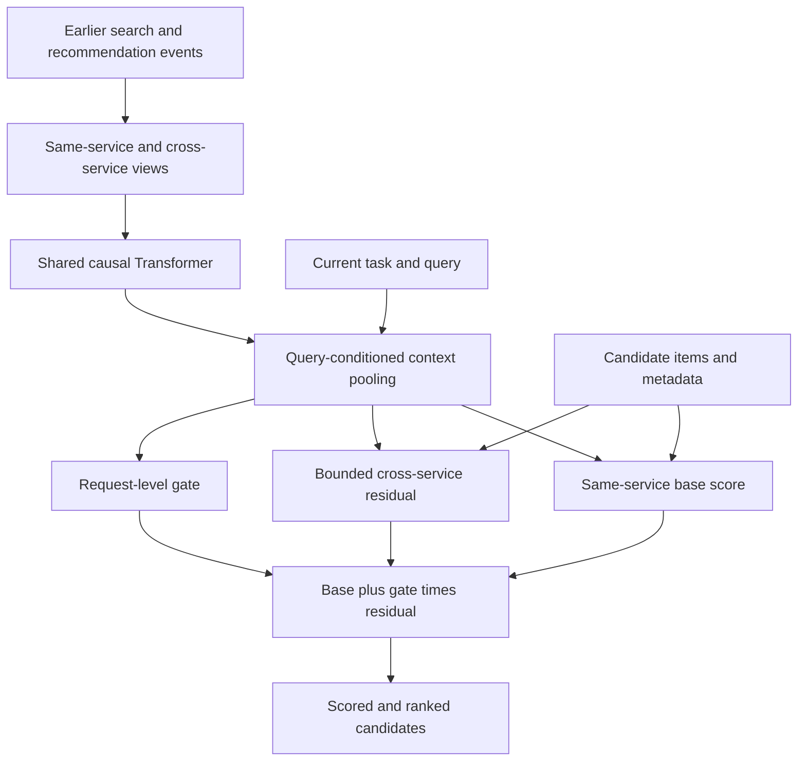

# TRACE

**Time-aware search and recommendation ranking with gated cross-service context.**

TRACE is a PyTorch ranking model that combines the current request with a user's earlier search and recommendation activity. Given candidate items, it returns a scored, ordered list through a CPU-runnable CLI or Python SDK.

[Download the trained model](https://github.com/Cyaside/TRACE/releases/tag/v2.1.0) · [Technical guide](docs/release.md) · [Dataset and reproduction](data/README.md)

## The problem

A user browsing recommendations can switch to a focused search. Their recent browsing may reveal useful interests, or reflect an intent they have already moved away from. Combining both histories introduces the possibility of irrelevant context influencing the ranking.

TRACE investigates how to control that contribution: keep a direct scoring path for the current service, then add a bounded contribution from the other service through a learned request-level gate.

The practical role is **ranking after candidate retrieval**. A search or discovery application supplies candidates and earlier activity; TRACE determines their order. The released weights are trained on anonymized short-video interactions from [KuaiSAR-small](https://kuaisar.github.io/).

## How it works



1. **Encode earlier activity.** Split the last 50 event blocks into same-service and cross-service views. For search, the cross-service view contains recommendation history; for recommendation, it contains search history. Histories must precede the current request.
2. **Model sequence and time.** A shared, one-layer causal Transformer encodes each view separately, using position, time-gap and event-age embeddings. Query-conditioned pooling summarizes the history.
3. **Score candidates.** The base network uses the current query, same-service context, item/caption representations, query-caption overlap and training-only exposure frequency. A second network computes the cross-service residual.
4. **Control the contribution.** A gate between zero and one scales the residual, which is bounded to [-2, 2]. The gate is shared across a request's candidates; the residual varies by candidate. Cross-service terms are zero when that history is absent.

```text
score(item) = base(item) + gate(request) × residual(item)
```

The encoder has width 64, two attention heads and 16-dimensional item/token embeddings. Training uses observed interactions directly: binary cross entropy for both tasks, a delta-NDCG@10 weighted pairwise search objective, and an auxiliary gate target derived from detached comparisons of the model's own branches. See the [method and training recipe](docs/release.md#how-the-model-works).

## Results

**Held-out test results for TRACE 2.1.0**, compared with trained logistic regression using metadata and history/query features on the same candidates:

| Model | Search user-macro NDCG@10 ↑ | Recommendation AP ↑ | Recommendation log loss ↓ |
|---|---:|---:|---:|
| TRACE 2.1.0 | 0.5141 | **0.7096** | **0.6154** |
| Logistic + metadata | **0.5151** | 0.6012 | 0.6847 |

TRACE achieved higher recommendation AP and lower recommendation log loss. Search NDCG remained slightly below the logistic baseline. This result does not establish a search improvement or isolate the gate as the cause of the recommendation gain.

The experiment uses a **10,000-user prepared cohort** with chronological splits: training before 29 May 2023, validation on 29 May and test on 30 May, all UTC+8. Vocabulary and exposure-frequency features use training data only. Model selection used validation results with fixed recommendation guardrails; the selected checkpoint was frozen before test evaluation.

The test includes **1,892 eligible search requests from 608 users** and **183,376 recommendation exposures**. NDCG measures ordering quality; AP summarizes precision across recall levels. Neither is a percentage of predictions answered correctly. Full aggregates and evaluation details are included as `metrics.json` and `MODEL_CARD.md` in the release.

## Try the trained model

Download **TRACE-2.1.0.zip** from the [v2.1.0 release](https://github.com/Cyaside/TRACE/releases/tag/v2.1.0). The approximately **184 MB** bundle includes trained weights, an installable wheel, example requests, a PowerShell launcher, the model card and checksums.

Install **Python 3.11**, extract the ZIP, and open PowerShell inside the extracted `TRACE-2.1.0` folder:

```powershell
# Search ranking
.\run-demo.ps1

# Recommendation ranking
.\run-demo.ps1 -Scenario recommendation
```

The first run installs CPU dependencies and needs an Internet connection. Subsequent inference runs locally. The included demo requires no GPU, training, hosting or dataset download.

The demo uses synthetic encoded requests with real trained weights. It shows the input history, a request gate, candidate scores and their order alongside a simple overlap/frequency rule. Those invented requests demonstrate the interface; the benchmark above uses held-out real interactions and the trained logistic baseline.

### CLI

After setup, use the included `request.json` as the encoded input example:

```powershell
.\.venv\Scripts\trace.exe rank --bundle . --input request.json --output result.json
.\.venv\Scripts\trace.exe verify --bundle .
```

### Python SDK

Run from the extracted bundle with the installed environment:

```python
import json
from pathlib import Path
from trace_ranking import TraceRanker

ranker = TraceRanker.from_bundle(".")
request = json.loads(Path("request.json").read_text(encoding="utf-8"))
result = ranker.rank(request)

for item in result["ranked_items"]:
    print(item["rank"], item["item_raw"], item["score"])
```

Inputs use the model's encoded vocabulary and feature contract. For raw benchmark IDs and anonymized query tokens, the optional `PreparedEncoder` uses locally rebuilt data to produce compatible inputs. See [input encoding and installation](docs/release.md#consumer-commands). Scores are uncalibrated logits; historical feedback is excluded from inference.

## Reproduce and explore

The release includes `source.zip` for a source checkout without downloading historical model exports. For development, install from the extracted source directory:

```powershell
py -3.11 -m venv .venv
.\.venv\Scripts\python.exe -m pip install -e ".[dev,train]"
.\.venv\Scripts\python.exe -m pytest -q
```

The released implementation passed **115 tests and 15 subtests**. Acceptance also covers isolated installed-wheel inference, extracted-bundle CLI/PowerShell execution, raw-encoder score parity and asset checksums.

| Explore | Entry point |
|---|---|
| Acquisition, cohort selection and temporal preparation | [Dataset guide](data/README.md) |
| Architecture and candidate batching | [TRACE model](src/models/trace_v2.py) |
| Delta-NDCG weighted search objective | [Ranking loss](src/models/ranking.py) |
| Training and checkpoint selection | [V2.1 trainer](src/training/trace_v21.py) |
| Controlled training variants | [Study configuration](configs/trace-v21-study.json) |
| CPU inference and input validation | [Runtime](src/serving/runtime.py) |
| Installation, encoding and package contents | [Usage guide](docs/release.md) |

The selected configuration, observed training environment and runtime versions accompany the model bundle. Data is downloaded from its original source and rebuilt with the documented preparation policy.

## Scope and limitations

Evaluation covers one selected seed on KuaiSAR video interactions. Candidate captions use the released static metadata snapshot, which limits conclusions about feature availability in a live system. Offline results do not establish online CTR/revenue uplift, robustness across seeds or a causal benefit from the gate.

TRACE supplies the ranking component. Full-catalog retrieval and exploration policies belong to the surrounding application. Applying the design to shopping or booking requires compatible domain data and training; the released video weights do not provide product or hotel semantics.

## License

Original TRACE source code and accompanying documentation are licensed under the [MIT License](LICENSE), copyright 2026 Cyaside.

This grant excludes datasets and trained model weight files. KuaiSAR data remains subject to its authors' [CC BY-NC-SA 4.0 terms](https://kuaisar.github.io/#license); third-party dependencies retain their own licenses. The MIT license for the code does not grant additional rights to use the dataset or model weights. See each model release's distribution notices for its terms.

## References

- [KuaiSAR](https://kuaisar.github.io/): the source search/recommendation dataset. Dataset terms are described in the [data guide](data/README.md#attribution-and-use).
- [Self-Attentive Sequential Recommendation — Kang and McAuley, 2018](https://arxiv.org/abs/1808.09781): background for the causal self-attention approach. TRACE independently adapts standard Transformer components to chronological exposure blocks and cross-service ranking.
