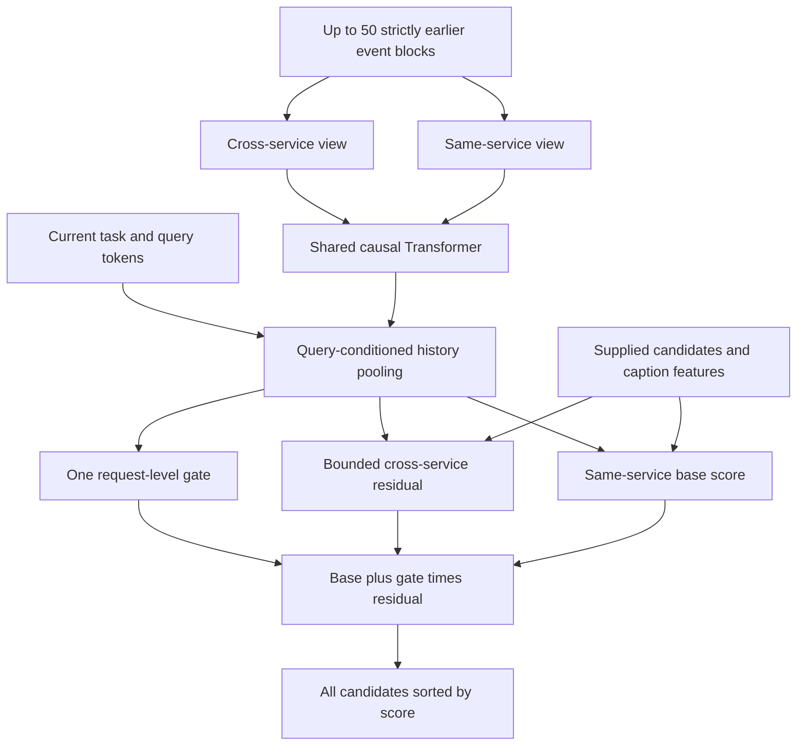

# Portable TRACE release

The installed package is `trace-ranking`; the public Python API is
`trace_ranking`. The portable ZIP contains the selected model and does not rely
on the developer's private folders. A wheel alone is the code distribution, not
the complete trained-model release.

Download the ZIP from the repository's v2.1.0 GitHub Release. Final weights are
distributed inside that asset; Git LFS is not required for this release bundle.

## Contents of a finalized bundle

| File | Purpose |
|---|---|
| `model.pt` | Selected inference weights, without optimizer/RNG state |
| `dist/*.whl` | Installable CLI and Python SDK |
| `demo.json`, `request.json` | Clearly synthetic inputs, without outcome labels |
| `MODEL_CARD.md`, `metrics.json` | Final benchmark results, baseline and limitations |
| `encoder-contract.json` | Vocabulary/feature/cohort/frequency compatibility |
| `ENVIRONMENT.json`, `requirements-runtime.txt` | Verified runtime versions |
| `TRAINING_CONFIG.json`, `TRAINING_ENVIRONMENT.json` | Selected model's recipe and observed training platform |
| `source.zip` | Code, configs, tests and dataset reconstruction instructions |
| `run-demo.ps1` | Windows CPU setup and demonstration |
| `release.json`, outer `.sha256` | File-integrity manifest and archive checksum |

The package's synthetic example exercises actual model inference. Real
KuaiSAR session replay is a separate optional workflow described in
[the CLI walkthrough](cli-demo.md); data payloads are not redistributed.

## How the model works

TRACE is a neural candidate ranker. It learns item/token embeddings, a shared
causal Transformer and small scoring networks directly from observed KuaiSAR
interactions. It does not use a teacher model or distillation.



For a search request, search history forms the same-service view and
recommendation history forms the cross-service view. Their roles reverse for
a recommendation request. Each view preserves chronology and uses the same
Transformer parameters; the streams do not attend to one another. Time-gap,
age and position embeddings describe when events happened. Query-conditioned
pooling summarizes each stream; recommendation uses a learned null-query vector.

The base network combines the current query, same-service summary, item and
caption embeddings, plus query-caption overlap and training-only exposure
frequency features. A second network computes a candidate-specific residual
from cross-service context. A single gate is shared across the request's
candidates:

`score(item) = base(item) + gate(request) * residual(item)`

The gate is between zero and one; the residual is bounded to [-2, 2]. Both
cross-service terms are zero when that history is absent. These constraints
limit the contribution mathematically; they do not guarantee better rankings
or prove that the gate has learned a causal explanation.

| Component | Selected recipe |
|---|---|
| Embeddings | 16 dimensions, PAD index 0, unknown identity index 1 |
| Sequence encoder | 1 Transformer layer, width 64, 2 attention heads, feedforward width 128 |
| History | Last 50 earlier exposure/query blocks; simultaneous events remain grouped |
| Search objective | Binary cross entropy plus normalized delta-NDCG@10 weighted pairwise loss |
| Recommendation objective | Binary cross entropy on observed positive and negative exposures |
| Training aids | Base/ungated branch losses, detached branch-utility targets for the gate, identity dropout |
| Optimizer | AdamW, learning rate 0.001, cosine schedule, gradient clipping at 1 |
| Logical update | 32 complete search requests and 256 sampled recommendation exposures |

The pairwise term uses at most 32 deterministic clicked/unclicked pairs per
request and weight 0.1; all candidate labels still contribute to the search BCE.
The utility target compares this model's base and ungated BCE on training
requests with a 0.005 margin. It trains the gate after a 1,000-update warmup;
these are internal branch comparisons, not outputs from another model.

V2.1 compares uniform ranking loss, delta-NDCG with utility, and delta-NDCG
without utility in three 4,000-update runs with matching initial parameters.
The release selects by validation search user-macro NDCG subject to fixed
recommendation guardrails, then freezes that checkpoint before final test.
The chosen run and checkpoint are recorded in MODEL_CARD.md. Three training
runs produce one selected inference model. Exact settings accompany the bundle
in TRAINING_CONFIG.json; the study configuration retains the controls.

The output is an ordered candidate list with uncalibrated scores. A product
integration supplies candidate retrieval, compatible event/metadata encoding
and its own domain training data. KuaiSAR video weights are not an immediately
trained hotel or shopping search engine. The released implementation provides
the ranking component and a runnable CPU interface for that component.

## Consumer commands

After installing the included wheel (or using `run-demo.ps1`):

```powershell
trace verify --bundle PATH_TO_EXTRACTED_BUNDLE
trace demo --bundle PATH_TO_EXTRACTED_BUNDLE --scenario search
trace demo --bundle PATH_TO_EXTRACTED_BUNDLE --scenario recommendation
trace rank --bundle PATH_TO_EXTRACTED_BUNDLE --input request.json --output result.json
trace about --bundle PATH_TO_EXTRACTED_BUNDLE
```

```python
from trace_ranking import TraceRanker
ranker = TraceRanker.from_bundle("PATH_TO_EXTRACTED_BUNDLE")
result = ranker.rank(encoded_request)
```

`rank` accepts encoded vocabulary indices and four candidate relevance features.
It discards supplied labels, checks valid vocabulary indices and requires
strictly earlier chronological history. Scores are uncalibrated logits. Current
supported tasks are `search` and `recommendation`; supplied candidates are ranked
without dropping any of them. This is not a full-catalog retrieval interface.

For raw benchmark ID/token input, install the wheel's `train` extra, rebuild the
10k preparation using [the data guide](../data/README.md), then:

```powershell
trace encode --bundle PATH_TO_EXTRACTED_BUNDLE --prepared PATH_TO_PREPARED_DATA --input raw-request.json --output encoded.json
trace rank --bundle PATH_TO_EXTRACTED_BUNDLE --input encoded.json --output result.json
```

Raw fields are `task`, `timestamp_ms`, `item_raw`, optional `query_tokens`, and
`history` blocks containing `timestamp_ms`, `service_mask`, `rec_items` and
`search_queries`. Optional IDs identify the request/user. Tokens are anonymized
numeric dataset tokens, not natural-language text. Unknown identities map to
index 1. The same static-caption availability assumption as training applies.

## Finalization for maintainers

`scripts.finalize_release` accepts a completed downloaded campaign, its submitted
source manifest, the original prepared data and matched baseline model. It
freezes the validation-selected candidate, runs/reuses a checksummed final test,
builds and tests an installed wheel outside the source tree, and assembles the
portable ZIP. It does not submit training jobs or publish to GitHub.

Run `python -m scripts.finalize_release --help` for paths. `--runtime-python` can
point to an isolated CPU environment for the installed-wheel test. A changed
model or evaluation implementation cannot silently reuse earlier test evidence.
No ready bundle is assembled when guardrails, final evaluation or installation
acceptance fail. Private reports and per-request predictions stay outside the
artifact allowlist.

Repository visibility, license choices and publication remain separate from
local artifact assembly. Use the current working rules when preparing a Git
commit/tag/upload; no build command performs those operations automatically.
